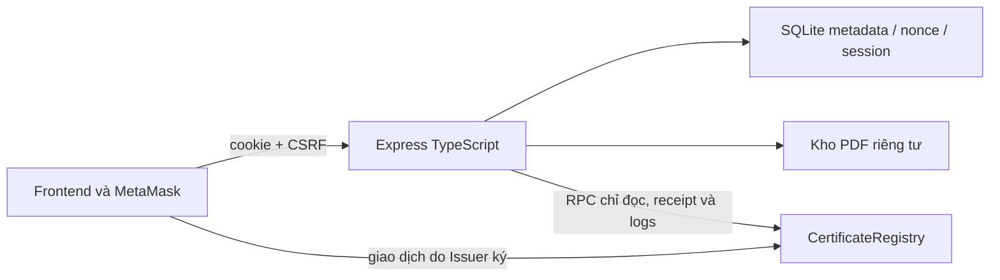

# Kiến trúc Backend EduCert

API không có signer hoặc khóa ví. Các lớp cấu hình, database, chain gateway, PDF, storage và routes được tách để dễ tích hợp và kiểm thử. Mọi dữ liệu chain đọc từ ABI/address/chainId trong `config/contract-config.json`.

Trạng thái chain: chưa tồn tại → đã cấp → đã thu hồi. Trạng thái đồng bộ: DRAFT → PENDING_CHAIN → ISSUED/REVOKED; lỗi giao dịch không hợp lệ có thể FAILED, lỗi RPC giữ PENDING_CHAIN để retry. Trạng thái đồng bộ không được thay thế trạng thái chain khi trả kết quả hiệu lực.

Auth dùng nonce gắn ví/domain/chain, chữ ký EIP-191, cookie session ngẫu nhiên lưu dạng HMAC trong SQLite. Yêu cầu ghi sau đăng nhập cần CSRF token và kiểm Origin. Kho PDF chỉ truy cập qua API có quyền; file cuối được băm lại khi đọc.

Sơ đồ đầy đủ theo đánh số hình của báo cáo (use case, kiến trúc tổng thể, vòng đời, tuần tự phát hành/xác minh): [DIAGRAMS.md](DIAGRAMS.md).
