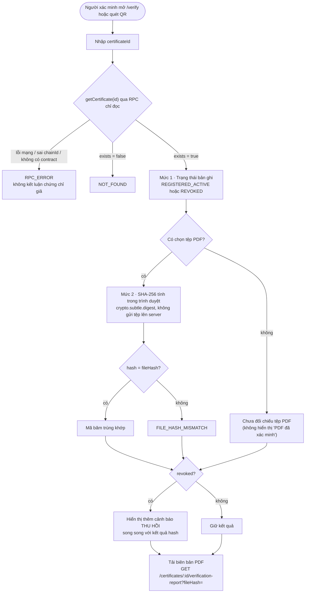
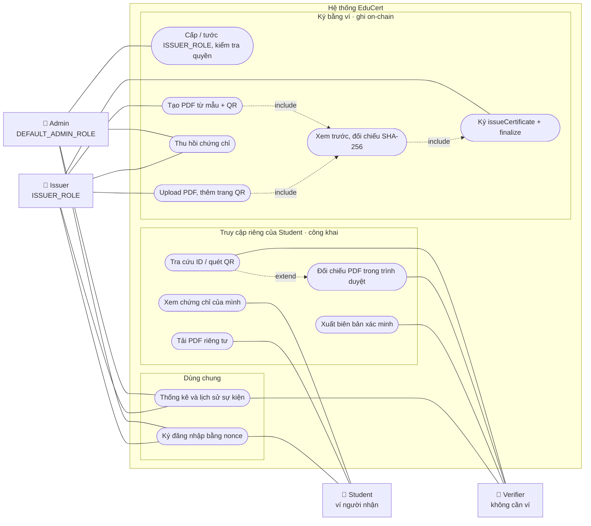
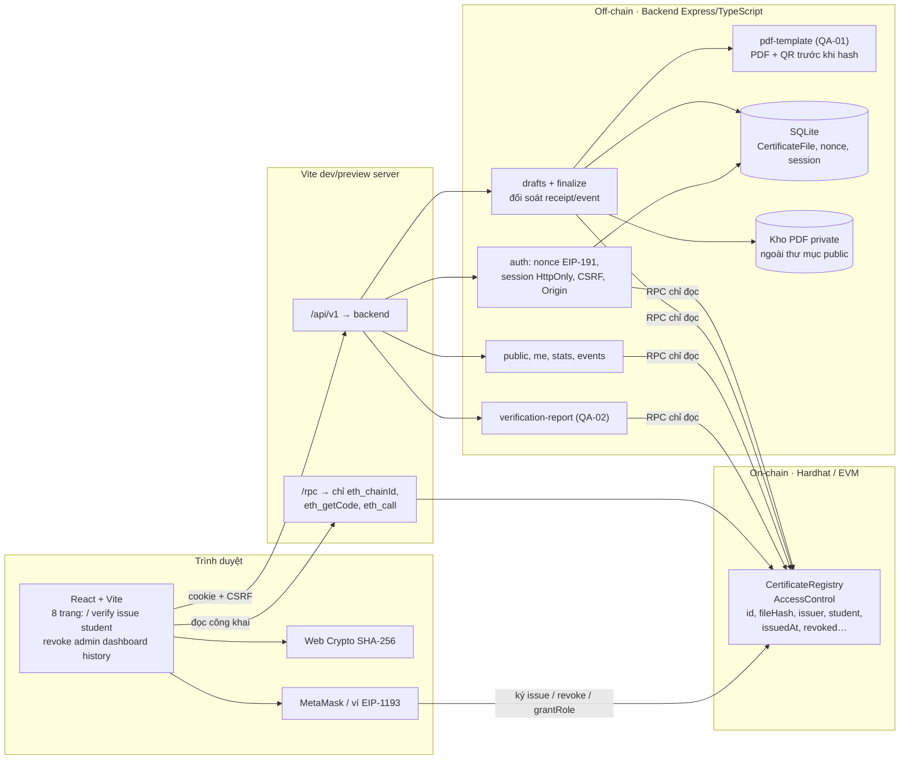
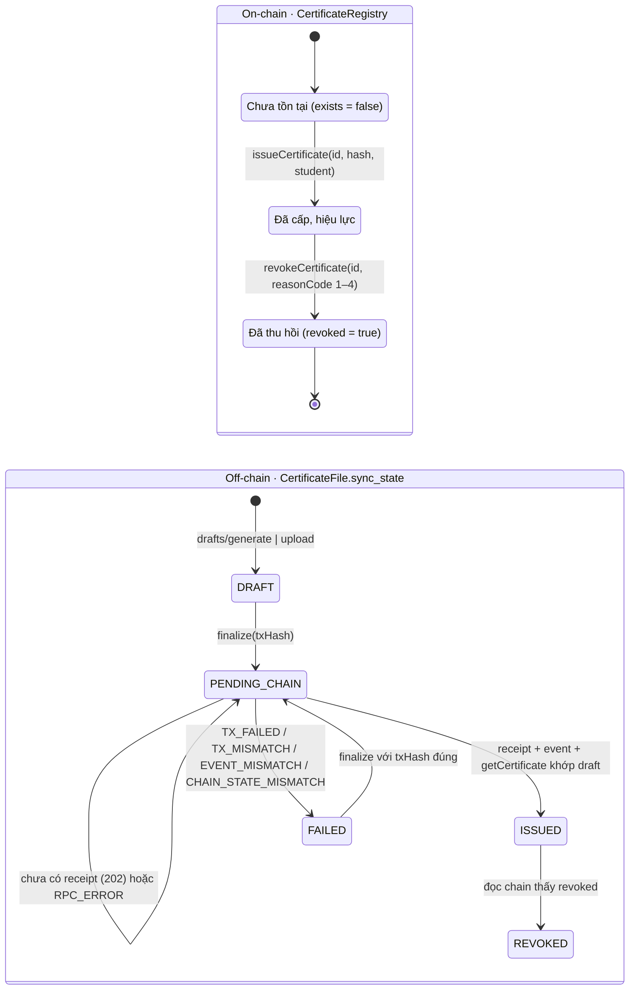
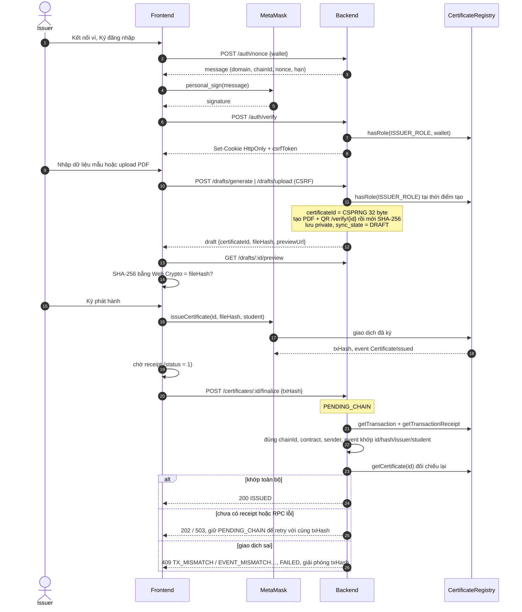
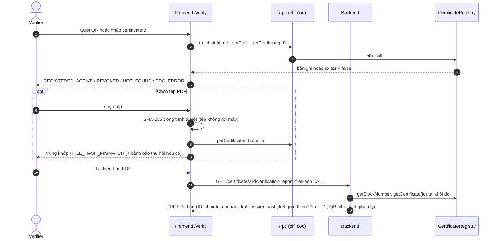

# Sơ đồ hệ thống EduCert (QA-04)

Người phụ trách: Hoàng Tùng (2351170630). Các sơ đồ được vẽ lại theo **mã nguồn đã triển khai** (hợp đồng, `backend/src`, `frontend/src`), dùng đánh số hình của báo cáo. GitHub hiển thị trực tiếp các khối Mermaid; bản SVG/PNG để chèn vào báo cáo nằm trong [`docs/diagrams/`](diagrams/) và được sinh lại bằng `npm --prefix e2e run diagrams`.

## Hình 1. Hai mức tra cứu bản ghi và xác minh toàn vẹn tệp PDF

## Hình 2. Sơ đồ trường hợp sử dụng của bốn nhóm tác nhân

Admin thu hồi mọi chứng chỉ; Issuer chỉ thu hồi chứng chỉ do chính mình cấp và khi vẫn còn `ISSUER_ROLE` (kiểm tra trong `revokeCertificate`). Tra cứu, đối chiếu, biên bản, thống kê và lịch sử là công khai.

## Hình 3. Kiến trúc tổng thể EduCert theo mô hình On-chain/Off-chain

Backend không giữ khóa ví nên không thể tự phát hành. `config/contract-config.json` là nguồn duy nhất cho ABI, địa chỉ hợp đồng và chainId. Dữ liệu cá nhân (tên, khóa học) chỉ nằm trong SQLite và PDF private; chain chỉ lưu ID, hash, ví và thời gian.

## Hình 4. Vòng đời chứng chỉ: trạng thái blockchain và trạng thái đồng bộ

Trạng thái đồng bộ chỉ phục vụ Backend (danh sách, retry). Kết quả hiệu lực luôn đọc từ chain; `FAILED` do giao dịch sai sẽ giải phóng `txHash` (BE-D12).

## Hình 5. Sơ đồ tuần tự phát hành chứng chỉ và xác thực giao dịch

## Hình 6 (bổ sung). Tuần tự xác minh công khai và xuất biên bản

